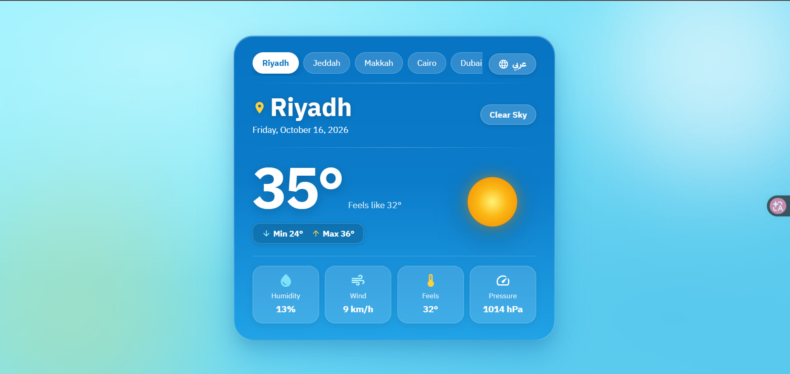

# 🌦️ Weather App

A fast, responsive, and bilingual weather application built with **React 19**, **Vite**, and **Material UI**. It fetches live weather data from the **OpenWeatherMap API** for major Arab cities, featuring an elegant glassmorphism UI and a clean component architecture.

---

## 📸 Preview



---

## 🌟 Features

- **Real-Time Weather Data**: Displays current temperature, feels-like temperature, humidity, wind speed, and atmospheric pressure.
- **Accurate 24-Hour Min/Max Forecast**: Calculates true daily highs and lows by analyzing the next 24-hour intervals from the forecast API.
- **Bilingual Interface (Arabic & English)**:
  - One-click language switching.
  - Automatic layout direction switching (`RTL` / `LTR`).
  - Localized dates using `Intl.DateTimeFormat`.
- **Preference Persistence (`localStorage`)**: Remembers the selected city and language across browser reloads.
- **Custom Vector Icons**: Crisp, handcrafted SVG icons for sun, moon, clouds, and rain that scale seamlessly across devices.
- **Loading Indicators**: Smooth spinner animations during asynchronous API requests.

---

## 🏗️ Project Architecture

The project follows the **Separation of Concerns (SoC)** principle to keep the UI decoupled from the data layer:

```text
weather-app/
├── public/                 # Static fonts (IBM Plex Sans Arabic)
├── src/
│   ├── Components/
│   │   ├── WeatherCard.jsx # Main weather card & internal state
│   │   ├── WeatherCard.css # Glassmorphism styling & animations
│   │   └── WeatherIcons.jsx# Isolated SVG icons & visual routing
│   ├── services/
│   │   └── weatherApi.js   # Axios client, data normalization & calculations
│   ├── App.jsx             # App root: language state & direction handling
│   ├── main.jsx            # React root & MUI ThemeProvider
│   └── App.css             # Global background & layout styles
├── .env                    # Secret API key (ignored by git)
└── package.json
```

---

## 🧠 Key Implementation Decisions

### 1. Data Normalization & Unit Conversion
The OpenWeatherMap API returns wind speed in meters per second (m/s). For a better user experience, it is converted to kilometers per hour (km/h) before reaching the UI:

```javascript
windSpeed: Math.round(data.wind.speed * 3.6)
```

### 2. Overcoming Current Weather API Limitations
The free `/weather` endpoint provides minimum and maximum temperatures scoped only to the exact moment of the request.
- **Approach**: We fetch the `/forecast` endpoint and inspect the first 8 intervals (covering the next 24 hours).
- **Helper Function**: Extracted the calculation into a clean `getMinMaxTemp` function that iterates through the upcoming readings to extract the true daily high and low.

### 3. Handling Network Race Conditions
When switching rapidly between cities, a slower network response from a previous selection could overwrite newer data.
- **Approach**: Used a cleanup flag (`isCancelled`) inside the `useEffect` hook to discard stale responses:

```javascript
useEffect(() => {
  let isCancelled = false;

  getCurrentWeather(selectedCity, locale).then((data) => {
    if (!isCancelled) {
      setWeather(data);
      setLoading(false);
    }
  });

  return () => {
    isCancelled = true;
  };
}, [selectedCity, locale]);
```

### 4. Lazy State Initialization
To avoid unnecessary synchronous reads from `localStorage` on every re-render, we pass an initializer function to `useState`:

```javascript
const [locale, setLocale] = useState(() => {
  return localStorage.getItem("weather_locale") || "ar";
});
```

### 5. Component Modularization
Extracted all raw SVG icons from `WeatherCard.jsx` into a dedicated `WeatherIcons.jsx` file with a `WeatherVisual` router component, reducing file size and improving maintainability.

---

## 🛠️ Tech Stack

- **React 19**
- **Vite**
- **Axios**
- **Material UI (MUI)**
- **OpenWeatherMap API**
- **CSS3** (Glassmorphism & Flexbox/Grid)

---

## 🚀 Getting Started

### 1. Clone the repository
```bash
git clone https://github.com/Ali-Tobar/weather-app.git
cd weather-app
```

### 2. Install dependencies
```bash
npm install
```

### 3. Set up the environment variable
Create a `.env` file in the root directory:
```env
VITE_OPENWEATHER_API_KEY=your_api_key_here
```

### 4. Start the development server
```bash
npm run dev
```

---

## 👨‍💻 Author

**Ali Tobar**  
Frontend Developer | Computer Science Student  
[GitHub Profile](https://github.com/Ali-Tobar)
